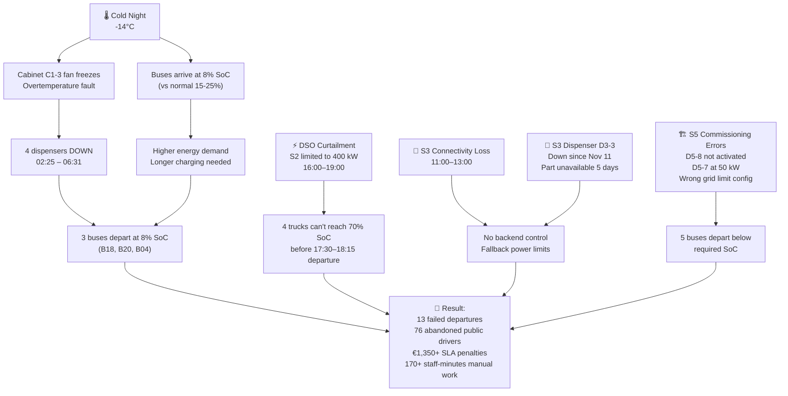
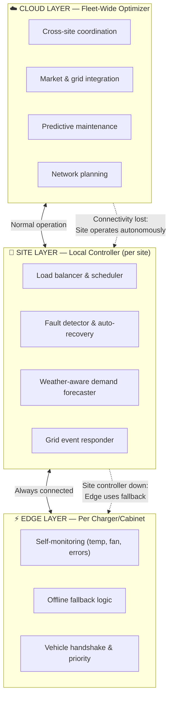
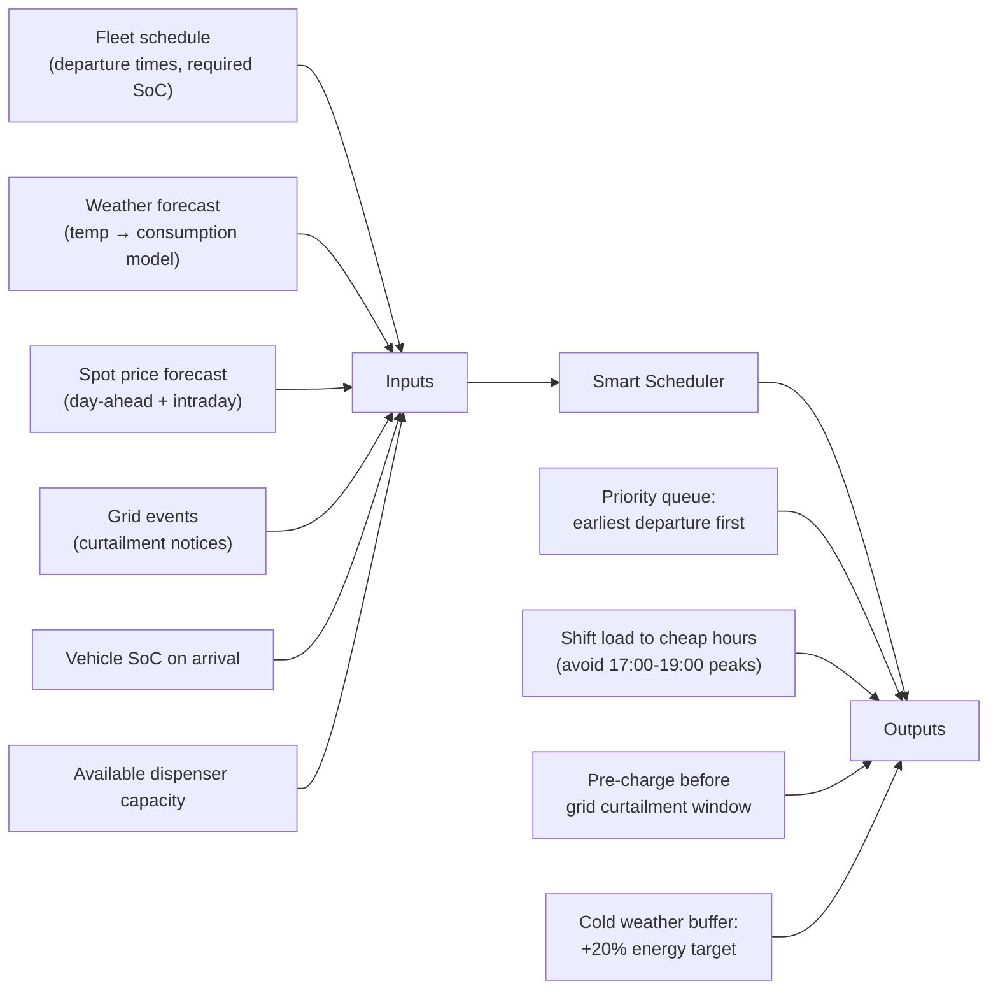
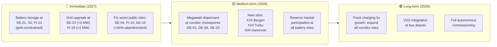

# Kempower Hackathon — Solution Ideas

## The Challenge

> *"If humans were no longer allowed to continuously operate and maintain a charging network, how would you redesign it?"*

Today, the network relies on **people in the loop** for everything: replugging vehicles at night, resetting faulted chargers, adjusting power manually during grid events, calling technicians, and changing prices. On the scenario day (Fri Nov 13), a perfect storm of cold weather, equipment faults, grid curtailment, and connectivity loss caused **13 failed bus/truck departures**, massive driver abandonment at public sites, and €1,350+ in SLA penalties — all requiring frantic human intervention.

---

## What Went Wrong on Scenario Day (Fri Nov 13)



---

## Solution Architecture: "The Autonomous Charging Network"

> [!IMPORTANT]
> The core idea: **Three layers of intelligence** — Edge (charger/cabinet), Site (local controller), and Cloud (fleet-wide optimizer) — each capable of operating independently when connectivity is lost.



---

## 💡 Solution Idea 1: Predictive Fault Prevention & Self-Healing

### The Problem Today
- Cabinet C1-3 overheated → fan failure → 4 dispensers down for 4+ hours during critical overnight charging
- Technician dispatched at 04:54, arrived 05:09, fixed at 06:31 — too late for 05:10 bus departures
- S3 dispenser down for **5 days** waiting for a spare part

### The Autonomous Solution

| Layer | What It Does |
|-------|-------------|
| **Edge** | Each cabinet monitors `cabinet_temp_c`, `fan_rpm`, `error_count` in real-time. Detects **trends** (rising temp, declining fan RPM) hours before failure. Triggers self-deration before critical shutdown. |
| **Site** | When a cabinet shows degradation: (1) Automatically redistributes vehicles to healthy dispensers — no manual "move_and_replug" needed, (2) Pre-charges priority vehicles first (earliest departure, lowest SoC), (3) Sends predictive alert: "Cabinet C1-3 fan degrading, recommend replacement within 48h" |
| **Cloud** | Maintains a **predictive maintenance model** trained on telemetry patterns across all 100 sites. Correlates weather forecasts with fault history (cold → fan/condensation issues). Pre-positions spare parts at nearby depots. Auto-dispatches technicians during business hours *before* failure. |

### How It Would Have Saved Nov 13
The system would have detected fan degradation **days before** Nov 13. With -14°C forecast, it would have:
1. Dispatched a technician on Nov 12 (daytime) to replace the fan preventively
2. Even if the fault still occurred, it would have **automatically moved B18, B20, B04 to other dispensers** instead of leaving them at 8% SoC

### Data Evidence
- [telemetry_1min.csv](file:///C:/Users/Codrut/Desktop/kempower-challenge-data/telemetry_1min.csv) — 1-minute `fan_rpm` and `error_events` data shows pre-failure patterns
- [telemetry.csv](file:///C:/Users/Codrut/Desktop/kempower-challenge-data/telemetry.csv) — `cabinet_temp_c` rising trend before fault
- [weather.csv](file:///C:/Users/Codrut/Desktop/kempower-challenge-data/weather.csv) — Temperature drop from 0°C to -14°C over Nov 12-13

---

## 💡 Solution Idea 2: Smart Charging Scheduler (Weather + Price + Grid Aware)

### The Problem Today
- Buses are plugged in randomly by night staff; charging order is first-come-first-served
- When grid curtailment hits (S2 limited to 400 kW), there's no automatic re-prioritization
- Charging happens regardless of spot price (€800/MWh at 18:00 vs €27/MWh at night)
- Nov 13 energy cost was **€668 for S1** (vs ~€450 on normal days)

### The Autonomous Solution



### Key Rules

1. **Departure-aware priority**: Vehicles with earliest departure and lowest SoC charge first — always
2. **Cold weather buffer**: When forecast < -10°C, increase target SoC by 10-20% (bus consumption is 20-40% higher in winter)
3. **Price-optimal scheduling**: For vehicles with long dwell times (overnight buses), shift charging to cheapest 15-min slots while guaranteeing departure SoC
4. **Grid event pre-charging**: When DSO curtailment is announced 2h ahead (as on Nov 13), immediately start charging all vehicles that need to depart during the curtailment window at maximum power
5. **Automatic dispenser assignment**: No manual "move and replug" — the system tells drivers which dispenser to use, or uses automated cable management

### Economic Impact

| Metric | Today (Nov 13) | With Smart Scheduler |
|--------|----------------|---------------------|
| S1 energy cost | €668 | ~€450 (shift to off-peak) |
| S2 trucks below SoC | 4 of 4 short-turn | 0 (pre-charge before curtailment) |
| S1 buses below SoC | 4 | 0 (priority scheduling + cold buffer) |
| Manual move/replug events | 21 across S1/S2/S5 | 0 (automated assignment) |
| Peak power cost | Max tariff | Reduced via load shaping |

### Network-Wide Savings

The **peak power fee** is €6.50–7.50/kW/month. Today's peak at S1 is 1,080 kW. Smart load shaping could reduce peak to ~800 kW, saving:
- S1: (1080-800) × €6.50 = **€1,820/month** in peak demand charges alone
- Across 100 sites: potentially **€50K–100K/month** in peak shaving savings

---

## 💡 Solution Idea 3: Battery Storage + Grid Services Revenue

### The Opportunity
- Nov 13 spot prices: **€27/MWh at night → €799/MWh at 18:00** (30x spread)
- Finnish FCR-D_up reserve market: avg **€20/MW/h** (€175K/MW/year revenue)
- Several sites are grid-constrained (SE-24: 149h over limit, SE-21: 147h) — battery solves this without grid upgrades

### The Design

| Component | Specification | Cost |
|-----------|--------------|------|
| Battery (energy) | 1 MWh | €320,000 |
| Battery (power) | 500 kW | €55,000 |
| **Total** | **1 MWh / 500 kW** | **€375,000** |

### Revenue Streams

| Stream | Annual Revenue (per 1 MWh system) |
|--------|----------------------------------|
| Spot price arbitrage (charge low, offset peaks) | €30K–70K |
| FCR-D_up reserve market (FI) | €35K–87K (for 500 kW) |
| Peak demand charge reduction | €20K–40K |
| Avoided grid upgrade costs | €50K+ (one-time) |
| **Total potential** | **€85K–197K/year** |

**Payback period: 2–4 years** on a €375K investment.

### Priority Sites for Battery

| Site | Why | Battery Size |
|------|-----|-------------|
| **SE-21** | Bus depot, 147h over grid, NO grid upgrade available | 2 MWh / 550 kW |
| **S2** | Logistics depot, subject to DSO curtailment | 500 kWh / 400 kW |
| **S1** | Bus depot, peak at 1,080 kW, high price exposure | 500 kWh / 300 kW |
| **FI-13** | Highway hub, 136h over grid, corridor chokepoint | 1 MWh / 500 kW |

### How It Would Have Saved Nov 13
- **S2**: Battery provides 400 kW during the 16:00–19:00 curtailment → trucks charge at 400 kW grid + 400 kW battery = 800 kW total → all 4 trucks reach 70% SoC on time
- **Price savings**: Battery charged at €30/MWh overnight, discharges at €800/MWh during evening peak → one cycle saves ~€770/MWh × 1 MWh = **€770 in a single evening**

---

## 💡 Solution Idea 4: Autonomous Public Site Management

### The Problem Today
- S3 (highway hub): **29.7% abandonment rate** on Nov 13 (76 of 256 drivers left)
- SE-04: **48.5% abandonment** over 14 days (8,264 lost customers!)
- Manual price changes (someone logs in and types a new price)
- No demand management — prices are flat regardless of queue length
- Connectivity outages leave the site "blind" for hours

### The Autonomous Solution

**Dynamic pricing engine:**
```
if queue_length > 2:
    price = base_price × (1 + 0.15 × queue_length)  # Surge pricing
if spot_price > 200 €/MWh:
    price = max(base_price, spot_price/1000 + margin)  # Pass through cost
if time_of_day in [02:00-06:00] and queue_length == 0:
    price = base_price × 0.8  # Off-peak discount to attract flexible demand
```

**Queue management:**
- Predict wait times based on current sessions' remaining energy needs
- Show drivers estimated wait time **before they arrive** (via app/navigation)
- Suggest nearby alternative sites with availability
- Reserve a slot in advance for fleet/subscription customers

**Offline resilience (for weak-connectivity sites like S3):**
- Edge controller runs full scheduling logic locally
- Cached price tables updated every connection window
- Local fault detection and auto-restart (no backend needed for `remote_reset`)
- Data syncs when connectivity returns

### Revenue Impact
- SE-04 loses ~8,264 sessions in 14 days. At avg 50 kWh × €0.35/kWh = **€144K lost revenue in 2 weeks**
- Dynamic pricing could recapture 30-50% through better demand distribution + off-peak incentives
- Surge pricing during peak hours increases revenue per session by 15-30%

---

## 💡 Solution Idea 5: Automated Commissioning & Configuration Validation

### The Problem Today
- S5 went live with **D5-8 not activated**, D5-7 at 50 kW instead of 150 kW
- Grid limit configured as 600 kW instead of actual 900 kW allocation
- "Parameters copied from S1 template" — wrong template used
- Test charges only done on 6 of 8 dispensers
- Result: 5 buses departed below required SoC on Nov 13

### The Autonomous Solution

**Automated commissioning checklist:**
```
✅ All dispensers powered on and reporting telemetry
✅ Each dispenser completed a test charge (≥10 kWh)
✅ Dispenser max_kw matches spec sheet (flag D5-7: 50 kW ≠ 150 kW expected)
✅ Site grid_limit matches DSO agreement (flag: config 600 kW ≠ agreement 900 kW)
✅ SIM cards active on all dispensers (flag D5-8: sim_active=false)
✅ Backend connectivity verified (round-trip command test)
✅ Load balancing verified (all cabinets share load)
✅ Emergency stop tested
```

**The system refuses to mark a site as "commissioned" until all checks pass.** No more "handover with open items."

### Historical Data
- [commissioning_history.csv](file:///C:/Users/Codrut/Desktop/kempower-challenge-data/commissioning_history.csv) shows **12 earlier sites** with rework rates and delays — trainable pattern for predicting commissioning risks
- Average commissioning has 2-3 blocker categories; automated validation eliminates "wrong config" and "untested dispenser" categories entirely

---

## 💡 Solution Idea 6: Cross-Site Fleet Coordination

### The Concept
S1 and S5 both serve customer C1 (city bus operator). When S1 is capacity-constrained (cabinet failure), the system could:
1. Reroute some buses to S5 (if operationally feasible)
2. Pre-position extra capacity at S5 knowing S1 has degraded hardware
3. Coordinate with the bus operator's dispatch system to adjust routes

### Network-Wide
- Corridor sites (DE-01, DE-06, SE-01, SE-07, SE-25) serve overlapping routes
- If one site is down/constrained, redirect trucks to the next corridor site
- Requires real-time availability sharing + navigation integration

---

## Which Solution to Demo? — Recommendation

> [!TIP]
> **Go deep on Solution 2 (Smart Scheduler) + Solution 1 (Predictive Faults)** for the demo. They directly address the scenario day failures and are demonstrable with the provided data.

### Demo Scenario: "Autonomous Friday the 13th"

Show how the system handles the same day **without humans**:

| Time | Event | Human Operator (Today) | Autonomous System |
|------|-------|----------------------|-------------------|
| Wed Nov 11 | Telemetry shows C1-3 fan RPM declining | Nobody notices | ⚡ Alert: "Fan degrading, dispatch technician tomorrow" |
| Thu Nov 12 14:00 | Weather forecast: -14°C overnight | Nobody adjusts | 🌡️ Cold buffer activated: target SoC raised to 95%, charging priority recalculated |
| Thu Nov 12 16:00 | Technician replaces fan (preventive) | — | ✅ C1-3 healthy, no overnight failure |
| Fri Nov 13 01:00 | Buses arrive at 8% SoC (cold weather) | Night staff randomly plugs buses | 🔌 Smart scheduler: B18, B20, B04 (05:10-05:35 departure) get priority on fastest dispensers |
| Fri Nov 13 14:00 | DSO announces S2 curtailment 16:00-19:00 | Operator manually adjusts power | ⚡ System immediately starts charging T01-T04 at max power (2h head start before curtailment) |
| Fri Nov 13 16:00 | S2 grid drops to 400 kW | Manual load adjustment (48 min) | 🔋 Battery supplements grid: 400 kW grid + 400 kW battery = 800 kW effective |
| Fri Nov 13 17:00 | Spot price hits €442/MWh | Nobody changes anything | 💰 Non-urgent charging paused, battery discharges, saves €500+ |
| Fri Nov 13 18:00 | Spot price hits €799/MWh | Nobody changes anything | 💰 Only critical departures charge, public price surges to pass through cost |
| **Result** | | 13 failed departures, 76 abandoned drivers, €2,000+ extra cost | **0 failed departures, <20 abandoned drivers, €800+ saved** |

---

## Business Model: "Charging-as-a-Service 2029"

### What the Customer Buys

| Tier | Target | What's Included | Pricing |
|------|--------|----------------|---------|
| **Fleet Assurance** | Bus/truck operators | Guaranteed departure SoC, weather-adjusted scheduling, predictive maintenance, SLA with financial penalty | €/vehicle/month + energy at cost |
| **Public Network** | CPO (own public sites) | Dynamic pricing engine, queue management, driver app, uptime guarantee | Revenue share (%) + platform fee |
| **Grid Flex** | Grid operators / markets | Reserve market participation, curtailment response, peak management | Revenue share from market proceeds |
| **Network Intelligence** | All | Cross-site coordination, expansion planning, commissioning automation | Included in platform fee |

### One-Page Service Agreement (Key Terms)

| Promise | Commitment | Accountability |
|---------|-----------|---------------|
| **Departure readiness** | ≥98% of fleet departures meet required SoC | Penalty per missed departure (replaces human operator cost) |
| **Charger uptime** | ≥97% dispenser availability (excl. planned maintenance) | Credits for downtime beyond SLA |
| **Fault response** | Critical: autonomous response <5 min; Technician on-site <4h | Escalation to human operator if autonomous fix fails |
| **Energy cost** | Optimized within ±5% of theoretical minimum | Transparent cost-plus billing, savings shared |
| **What system decides alone** | Charging order, power distribution, price adjustments, remote resets, technician dispatch, battery cycling | Customer sets policies (min SoC, max price, priority rules); system executes |
| **What needs human approval** | Grid upgrade investment, new site commissioning sign-off, SLA terms changes, firmware updates affecting safety | System recommends; human approves |
| **When it decides wrong** | Automatic incident report within 1h, root cause within 24h | Insurance-backed liability for equipment damage; financial penalties for SLA breach |

---

## Growth & Network Expansion Strategy

### Priority Investments (2027-2029)



### The Numbers

| Investment | Cost | Annual Return | Payback |
|-----------|------|---------------|---------|
| Battery at SE-21 (2 MWh) | €750K | €150K–250K (saved penalties + reserve market) | 3–5 years |
| Grid upgrade SE-24 (+3 MW) | ~€900K | €200K+ (recaptured sessions) | 4–5 years |
| Fix SE-04 (add dispensers) | ~€200K | €500K+/year (recaptured revenue from 8,264 lost sessions) | <6 months |
| Smart scheduling software | ~€500K dev | €600K–1.2M/year (peak shaving + price optimization across 100 sites) | <1 year |

---

## 10-Minute Pitch Structure — "2029 Customer Story"

### Suggested Narrative

> **Characters:** Maria, fleet manager at a Nordic bus company (50 electric buses, 3 depots)
>
> **2026 (today):** Maria gets a 3am call — it's -15°C, a charger cabinet is down, 6 buses can't charge, the morning routes are at risk. She calls the technician, drives to the depot, manually replugs buses. Total cost: one sleepless night, 3 buses with insufficient charge, 2 canceled routes, angry passengers.
>
> **2029 (with autonomous system):** Same cold night, same cabinet showing stress. But at 2pm the previous day, Maria got a notification: "Fan replacement recommended at Depot North, technician scheduled for tomorrow 9am." The fan was replaced before the cold hit. Her buses charged in optimal order. She slept through the night. Zero canceled routes.
>
> **The punchline:** Maria doesn't buy chargers anymore. She buys **departure readiness** — a guarantee that her buses leave on time, charged, every morning. The system decides how. She decides what matters.

### Pitch Flow (10 min)

| Min | Content |
|-----|---------|
| 0-2 | Maria's nightmare (the Nov 13 story, real data) |
| 2-4 | "What if the network operated itself?" (architecture, 3 layers) |
| 4-6 | Live demo: same data, autonomous handling (spreadsheet or code) |
| 6-8 | Business model: what Maria buys in 2029 |
| 8-9 | The numbers: cost savings, revenue opportunities, growth |
| 9-10 | One slide: "Departure Readiness as a Service" — the future |

